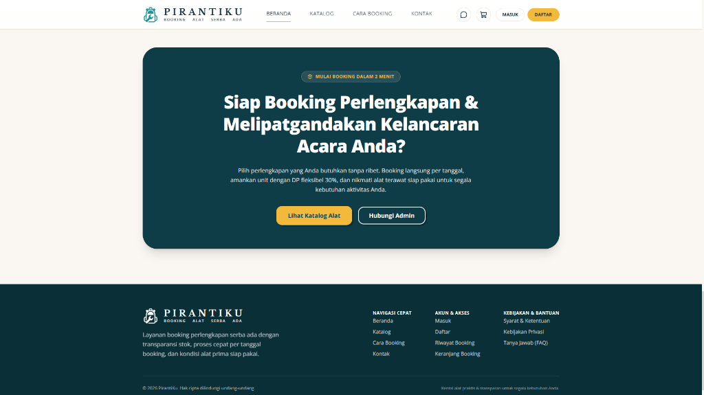

# 🛠️ PirantiKu — Platform Booking & Rental Alat Serba Ada

<p align="center">
  
</p>

<p align="center">
  <strong>Solusi Penyewaan Peralatan Terpadu dengan Kepastian Stok Real-Time, Kalkulasi DP Fleksibel, dan Manajemen Operasional Berbasis Cloud.</strong>
</p>

<p align="center">
  <a href="#1-identitas-proyek">Identitas Proyek</a> •
  <a href="#2-fitur-utama--tangkapan-layar">Fitur Utama & Tangkapan Layar</a> •
  <a href="#3-teknologi-yang-digunakan-tech-stack">Tech Stack</a> •
  <a href="#4-panduan-instalasi--cara-menjalankan">Panduan Instalasi</a> •
  <a href="#5-akun-demo--data-pengujian">Akun Pengujian</a>
</p>

---

## 1. Identitas Proyek

### 📌 Judul & Deskripsi Singkat
**PirantiKu** adalah platform web modern untuk penyewaan peralatan serba ada (Outdoor & Pendakian, Konstruksi & Perkakas, Olahraga, Perlengkapan Acara/Pesta, Kamera & Elektronik, Otomotif, hingga Alat Rumah Tangga). 

**Masalah yang Diselesaikan:**
* **Ketidakpastian Stok:** Mencegah terjadinya peminjaman ganda (*double-booking*) pada tanggal yang sama dengan algoritma validasi ketersediaan unit fisik real-time berbasis PostgreSQL RPC.
* **Proses Booking Konvensional:** Menggantikan pencatatan manual via chat/kertas menjadi sistem reservasi digital yang transparan dengan kalkulasi otomatis uang muka (DP), deposit jaminan, dan diskon sewa mingguan ($\ge 7$ hari).
* **Verifikasi & Rekonsiliasi:** Memfasilitasi alur verifikasi pembayaran transfer/QRIS, pencetakan invoice digital siap cetak, serta rekonsiliasi pengembalian barang dan denda kerusakan secara sistematis.

### 👤 Identitas Pengembang
| Data | Keterangan |
| :--- | :--- |
| **Nama Lengkap** | Devr1us (Aditya) |
| **NIM / ID Peserta** | `[Isi NIM / ID Anda di sini]` |
| **Kelas / Jurusan** | `[Isi Kelas / Program Studi Anda di sini]` |
| **Instansi / Universitas**| `[Isi Nama Sekolah / Kampus di sini]` |
| **Peran (Role)** | Full-Stack Developer (UI/UX, Frontend, Backend & Database Architecture) |

### 🌐 Tautan Proyek & Demo Langsung
* **Live Demo Website:** [https://pirantiku.vercel.app](https://pirantiku.vercel.app) *(atau domain kustom Anda)*
* **Repositori GitHub:** [https://github.com/Devr1us/PirantiKu](https://github.com/Devr1us/PirantiKu)

---

## 2. Fitur Utama & Tangkapan Layar

### 🌟 Fitur Sisi Pelanggan (Customer)
1. **Katalog Cerdas & Filter Presisi:**
   - Navigasi berdasarkan 8 kategori alat lengkap dengan pagination dan pencarian instan.
   - Filter cepat rentang harga sewa harian (*price preset pills*) dan filter ketersediaan unit.
2. **Mesin Kalender Anti Double-Booking:**
   - Pemilihan rentang tanggal sewa fleksibel.
   - Tanggal yang stok unit fisiknya telah habis otomatis dinonaktifkan (*disabled date* via PostgreSQL RPC `tanggal_penuh`).
3. **Kalkulasi Biaya Transparan & DP Dinamis:**
   - Perhitungan durasi hari sewa inklusif.
   - Diskon tarif otomatis untuk sewa jangka panjang ($\ge 7$ hari).
   - Besaran persentase DP terhubung langsung dengan pengaturan dinamis toko di database.
4. **Keranjang Belanja Persisten:**
   - Keranjang belanja disimpan di `localStorage` dengan penanganan `useSyncExternalStore` untuk mencegah kendala *SSR hydration mismatch*.
5. **Alur Pembayaran & Upload Bukti Transfer:**
   - Pilihan metode Transfer Bank (BCA, Mandiri, BRI, BNI) atau kode QRIS.
   - Kompresi gambar client-side via HTML5 Canvas sebelum upload untuk menghemat bandwidth.
   - *Smart Polling* status pembayaran yang mendeteksi verifikasi admin secara otomatis.
6. **Nota & Komunikasi Terintegrasi:**
   - Invoice digital ramah cetak (*print-ready*).
   - Tombol konfirmasi otomatis 1-klik menuju WhatsApp Admin resmi dengan template pesan terformat rapi.

### 🛡️ Fitur Sisi Pengelola (Administrator)
1. **Dashboard Operasional Terpadu:**
   - Monitoring total unit alat, unit siap disewa, unit sedang dirental, dan antrean booking baru.
2. **Manajemen Katalog & Kategori (CRUD):**
   - Tambah, edit spesifikasi, update harga sewa harian/mingguan, kuota stok total, dan stok rusak.
3. **Kalender Reservasi Interaktif:**
   - Visualisasi jadwal sewa alat per tanggal untuk kemudahan pemantauan logistik armada alat.
4. **Verifikasi Pembayaran & Penolakan Terstruktur:**
   - Pratinjau bukti transfer penyewa dengan opsi persetujuan instan atau penolakan disertai catatan alasan.
5. **Inspeksi Pengembalian & Kalkulasi Denda Otomatis:**
   - Deteksi otomatis keterlambatan pengembalian unit dan nominal denda harian.
   - Form inspeksi kondisi fisik alat (`baik`, `rusak_ringan`, `rusak_berat`, `hilang`) beserta input biaya ganti rugi.
   - Kalkulasi otomatis pengembalian uang jaminan: $\text{Deposit Bersih} = \text{Deposit Awal} - (\text{Denda} + \text{Ganti Rugi})$.
6. **Pengaturan Konfigurasi Toko:**
   - Pengelolaan nomor rekening bank, link QRIS, kontak WhatsApp admin, lokasi workshop (Google Maps embed), dan persentase DP.

---

### 📸 Tangkapan Layar Aplikasi

#### 1. Halaman Beranda (Hero Section & Value Proposition)
Tampilan antarmuka beranda yang modern, bersih, dan menyajikan nilai utama layanan sewa.


#### 2. Katalog Rental & Filter Harga
Pencarian alat cepat dilengkapi dengan filter kategori dan pil rentang harga yang ringkas.


#### 3. Lokasi Workshop & Informasi Kontak
Peta interaktif titik temu pengambilan alat fisik terintegrasi dengan tautan langsung Google Maps dan WhatsApp.


#### 4. Call-to-Action & Footer Navigasi
Akses navigasi terstruktur untuk seluruh halaman fungsional aplikasi.


---

## 3. Teknologi yang Digunakan (Tech Stack)

| Kategori | Teknologi | Deskripsi / Peran |
| :--- | :--- | :--- |
| **Framework Utama** | **Next.js 16 (App Router)** | Server Components, Server-Side Rendering (SSR), & API Routes |
| **Bahasa Pemrograman** | **TypeScript 5** | Strict Type Safety di seluruh model database dan antarmuka komponen |
| **Library UI** | **React 19** | Komposisi komponen reaktif modern |
| **CSS & Desain** | **Tailwind CSS v4** | Sistem styling utility-first yang ringan dan responsif mobile-desktop |
| **Komponen UI Primitif**| **Radix UI** | Komponen aksesibel (Dialog, Tabs, Dropdown Menu, Sheet Drawer) |
| **Ikon Antarmuka** | **Lucide React** | Ikonografi modern, konsisten, dan ringan |
| **Animasi** | **Motion (Framer Motion)**| Transisi mikro, animasi layout, dan visual interaktif |
| **Notifikasi** | **Sonner** | Notifikasi toast interaktif |
| **Manajemen Form** | **React Hook Form + Zod**| Validasi skema input data pengguna dan formulir admin |
| **Basis Data & Autentikasi** | **Supabase (PostgreSQL)** | Layanan database cloud, Auth SSR, Storage Bucket, dan Row-Level Security |
| **Keamanan Edge** | **Next.js Middleware** | Proteksi rute admin dan rute privat di tingkat jaringan server |
| **Platform Hosting** | **Vercel** | CI/CD otomatis terhubung langsung dengan repositori Git |

---

## 4. Panduan Instalasi & Cara Menjalankan

Ikuti langkah-langkah berikut untuk menguji dan menjalankan proyek ini di komputer lokal Anda:

### ⚙️ Prasyarat (Prerequisites)
Pastikan komputer Anda telah terinstal:
* **Node.js**: Versi `18.18.0` atau `20.x` ke atas ([Unduh Node.js](https://nodejs.org/))
* **Git**: Versi terbaru
* **Package Manager**: `npm` (bawaan Node.js) atau `pnpm`

### 📥 Langkah Instalasi

1. **Clone Repositori:**
   ```bash
   git clone https://github.com/Devr1us/PirantiKu.git
   cd PirantiKu
   ```

2. **Pasang Seluruh Dependensi:**
   ```bash
   npm install
   ```

3. **Konfigurasi Environment Variables:**
   Salin berkas template environment:
   ```bash
   cp .env.example .env.local
   ```
   Buka file `.env.local` dan sesuaikan nilainya:
   ```env
   # URL Aplikasi Lokal
   NEXT_PUBLIC_APP_URL=http://localhost:3000

   # Kredensial Project Supabase Anda
   NEXT_PUBLIC_SUPABASE_URL=https://sihxbidxdclkjgrtwqft.supabase.co
   NEXT_PUBLIC_SUPABASE_ANON_KEY=sb_publishable_alGPaPx8hw0hrjSClcYN5g_UVH2H3yJ
   ```

4. **Inisialisasi Database (Jika Menggunakan Project Supabase Baru):**
   * Buka **Supabase Dashboard > SQL Editor**.
   * Eksekusi skrip migrasi yang tersedia di folder `supabase/migrations/`:
     1. `01_schema_and_policies.sql` *(Struktur tabel, RLS, & Fungsi RPC)*
     2. `02_seed_equipment_images.sql` *(Data awal 57 item alat rental)*
     3. `03_fix_stock_and_overloads.sql` *(Optimasi fungsi ketersediaan stok)*
     4. `04_setup_payment_proofs_bucket.sql` *(Storage bucket bukti transfer)*

5. **Jalankan Server Pengembangan (Localhost):**
   ```bash
   npm run dev
   ```
   Buka peramban (*browser*) Anda di alamat: **[http://localhost:3000](http://localhost:3000)**.

---

## 5. Akun Demo / Data Pengujian

Untuk mempermudah proses penilaian fitur multi-role tanpa harus mendaftar dari awal, silakan gunakan akun uji coba berikut:

### 🔑 1. Akun Administrator (Pengelola Toko)
* **URL Login:** [http://localhost:3000/admin/login](http://localhost:3000/admin/login)
* **Email:** `admin@pirantiku.id`
* **Password:** `AdminPirantiKu2026!`
* **Hak Akses:**
  * Mengakses Dashboard Ringkasan Operasional (`/admin`)
  * Mengelola, menambah, dan mengubah data katalog alat (`/admin/alat`)
  * Memverifikasi pembayaran DP dan menolak bukti transfer (`/admin/booking`)
  * Memantau ketersediaan armada alat di Kalender Rental (`/admin/kalender`)
  * Melakukan inspeksi pengembalian, input denda/kerusakan, dan refund deposit
  * Mengubah informasi rekening toko, nomor WhatsApp, dan tarif DP (`/admin/pengaturan`)

> [!TIP]
> **Opsi Menjadikan Akun Anda Sendiri sebagai Admin:**
> Jika Anda mendaftar akun baru melalui halaman `/daftar` dan ingin menjadikannya sebagai Administrator, jalankan query berikut di **Supabase SQL Editor**:
> ```sql
> UPDATE public.profiles 
> SET role = 'admin' 
> WHERE id = (SELECT id FROM auth.users WHERE email = 'email_anda@gmail.com');
> ```

---

### 👤 2. Akun Pelanggan (Penyewa Alat)
* **URL Login:** [http://localhost:3000/login](http://localhost:3000/login)
* **Email:** `penyewa@pirantiku.id`
* **Password:** `Penyewa2026!`
* **Hak Akses:**
  * Menjelajahi katalog alat dan melihat ketersediaan stok tanggal
  * Menambahkan unit ke keranjang belanja (`/keranjang`)
  * Melakukan checkout pemesanan sewa (`/checkout`)
  * Melakukan konfirmasi pembayaran dan upload bukti transfer (`/pembayaran/[kode]`)
  * Melihat riwayat transaksi dan melacak status pesanan (`/booking-saya`)
  * Mengunduh dan mencetak nota transaksi resmi (`/invoice/[kode]`)

---

## 📄 Lisensi & Hak Cipta
Hak Cipta © 2026 **PirantiKu**. Dikembangkan oleh **Devr1us (Aditya)**.  
Didedikasikan untuk standarisasi platform reservasi sewa alat yang transparan, aman, dan efisien.
