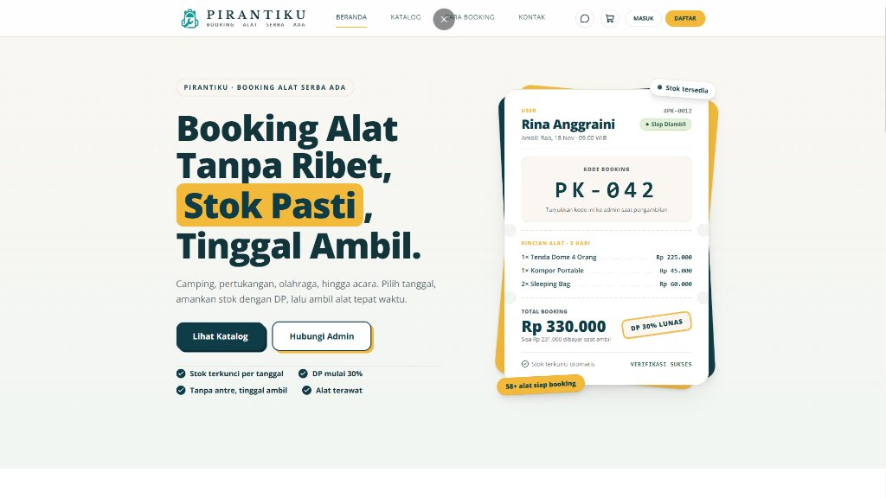
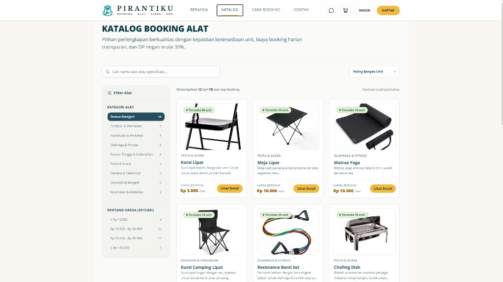
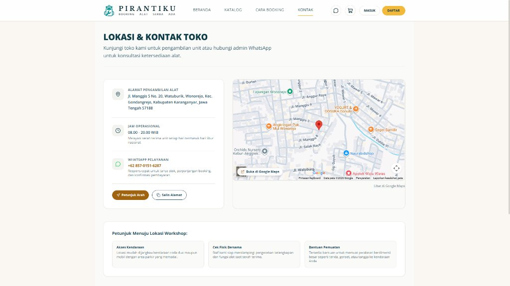

# 🛠️ PirantiKu — Booking Alat Serba Ada

> **Platform reservasi dan sewa perlengkapan terpadu** (Outdoor, Perkakas, Olahraga, Pesta, Kamera, Otomotif, hingga Rumah Tangga) dengan kepastian stok per tanggal, sistem uang muka (DP) fleksibel, validasi transaksi aman berbasis PostgreSQL RPC, serta panel pengelola lengkap.

---

## 📸 Preview Tampilan Aplikasi

Berikut adalah dokumentasi antarmuka utama sistem PirantiKu:

### 1. Beranda & Hero Section
Tampilan utama yang menyajikan penawaran nilai, transparansi stok siap ambil, dan pratinjau tiket booking interaktif.


### 2. Katalog Booking & Filter Kategori
Pencarian alat instan dengan filter kategori dinamis, rentang harga, ketersediaan unit fisik real-time, dan status kesiapan unit.


### 3. Lokasi Workshop & Kontak Toko
Integrasi peta Google Maps interaktif, alamat titik pengambilan unit fisik, jam operasional, serta tombol kontak WhatsApp layanan pelanggan.


### 4. Call-to-Action & Navigasi Cepat
Akses cepat bagi calon penyewa untuk menjelajahi katalog atau berkonsultasi langsung dengan admin operasional.


---

## ✨ Fitur-Fitur Utama

### 🛒 Sisi Pelanggan (Customer Flow)
- **Katalog Alat & Filter Cerdas**: Jelajahi puluhan alat berdasarkan kategori, ketersediaan stok, dan rentang harga sewa harian.
- **Kalender Sewa Anti Double-Booking**: Memilih tanggal mulai dan selesai dengan tanggal penuh yang otomatis dinonaktifkan (`tanggal_penuh` RPC).
- **Kalkulasi Biaya Otomatis & Diskon Mingguan**:
  - Durasi sewa dihitung inklusif.
  - Diskon sewa otomatis untuk peminjaman $\ge 7$ hari.
  - Pembagian nominal transparan: DP (30%), Uang Jaminan (Deposit), dan Pelunasan saat pengambilan unit.
- **Keranjang Belanja Persisten**: Keranjang belanja tersimpan aman di `localStorage` menggunakan `useSyncExternalStore` (mencegah *hydration mismatch*) dan otomatis dibersihkan saat sesi akun berganti.
- **Pembayaran Fleksibel**: Pilihan metode Transfer Bank (BCA, Mandiri, BRI, BNI) atau QRIS dinamis dengan hitung mundur batas pembayaran 24 jam.
- **Kompresi Bukti Transfer di Browser**: Gambar struk/bukti bayar dikompresi otomatis via HTML5 Canvas sebelum diunggah ke server untuk menghemat kuota dan mempercepat upload.
- **Status Pembayaran Real-Time (Smart Polling)**: Halaman pembayaran mendeteksi verifikasi admin secara otomatis tiap 4 detik dan otomatis berhenti saat tab tidak aktif (*visibility change listener*).
- **Invoice Digital Print-Ready**: Cetak bukti booking dan serah terima resmi dalam format nota standar.

### 🛡️ Sisi Pengelola (Admin Flow)
- **Dashboard Ringkasan Operasional**: Statistik total alat, unit fisik tersedia, unit yang sedang disewa, dan rekap pesanan terbaru.
- **Verifikasi Pembayaran & Penolakan Terstruktur**: Admin dapat menyetujui DP atau menolak bukti transfer tidak valid beserta alasan penolakannya.
- **Inspeksi Pengembalian Unit & Kalkulasi Denda**:
  - Perhitungan denda keterlambatan per hari otomatis.
  - Form pengecekan kondisi unit per item (`baik`, `rusak_ringan`, `rusak_berat`, `hilang`) beserta foto dokumentasi.
  - Kalkulasi pengembalian uang deposit: `Deposit Bersih = Deposit Awal - Denda - Biaya Ganti Rugi`.
- **Manajemen Katalog & Kategori**: Tambah, ubah data alat, atur harga harian/mingguan, serta perbarui kuota stok unit.
- **Manajemen Akun Pengguna**: Perlindungan integritas data (pengguna dengan pesanan aktif tidak dapat dihapus sembarangan).

---

## 🏗️ Arsitektur & Teknologi

| Lapisan | Teknologi | Keterangan |
| :--- | :--- | :--- |
| **Framework** | Next.js 16 (App Router) | Server-Side Rendering (SSR) & Server Components |
| **Bahasa** | TypeScript | *Strict type safety* di seluruh alur data |
| **Library UI** | React 19, Tailwind CSS v4 | Antarmuka responsif dan performa render cepat |
| **Komponen & Ikon** | Radix UI, Lucide React, Sonner | Komponen aksesibel dan notifikasi toast interaktif |
| **Animasi** | Motion (Framer Motion) | Transisi mikro halus dan efek visual bertahap |
| **Form & Validasi** | React Hook Form & Zod | Validasi skema input data sisi client dan server |
| **Backend & DB** | Supabase (PostgreSQL) | Auth, Storage Bucket, Relational DB, & RPC |
| **Keamanan** | Next.js Middleware & Supabase RLS | Pembagian otorisasi ketat antara `user` dan `admin` |

---

## 📂 Struktur Direktori Proyek

```plaintext
PirantiKu/
├── app/                        # Next.js App Router
│   ├── (auth)/                 # Rute Autentikasi (login, daftar, verify-otp)
│   ├── admin/                  # Panel Dashboard & Operasional Pengelola
│   ├── alat/                   # Katalog dan detail unit alat rental
│   ├── api/                    # Endpoint API Route Handlers
│   ├── booking-saya/           # Halaman riwayat dan status booking user
│   ├── checkout/               # Alur pembuatan pesanan & eksekusi RPC
│   ├── invoice/                # Halaman dan tampilan nota transaksi
│   └── pembayaran/             # Instruksi bayar & verifikasi bukti transfer
├── components/                 # Komponen antarmuka modular
│   ├── admin/                  # Komponen khusus panel pengelola & return modal
│   ├── booking/                # Date picker dan widget reservasi
│   ├── equipment/              # Card katalog dan detail widget alat
│   ├── invoice/                # Komponen nota siap cetak
│   ├── payment/                # Alur pembayaran dan selector bank
│   └── ui/                     # Primitif UI (Button, Dialog, Input, Badge, dll)
├── hooks/                      # Custom React hooks (useBookingStatusPolling, dll)
├── lib/                        # Logika bisnis inti & koneksi layanan
│   ├── cart-context.tsx        # State management keranjang belanja
│   ├── constants.ts            # Konstanta aplikasi & fallback data
│   ├── format.ts               # Format mata uang Rupiah & tanggal lokal
│   ├── inventory.ts            # Logika perhitungan stok fisik alat
│   ├── payment-utils.ts        # Kompresi gambar Canvas & helper pembayaran
│   ├── pricing.ts              # Rumus sewa, diskon mingguan, & deposit
│   └── supabase/               # Klien Supabase (server & browser client)
├── public/                     # Aset statis & tangkapan layar (screenshots)
├── types/                      # TypeScript database skema & entity types
└── middleware.ts               # Proteksi rute edge & otentikasi role RBAC
```

---

## 🚀 Panduan Instalasi Lokal

### 1. Clone Repository & Masuk ke Folder Proyek
```bash
git clone https://github.com/username/PirantiKu.git
cd PirantiKu
```

### 2. Pasang Dependensi
```bash
npm install
# atau
pnpm install
```

### 3. Konfigurasi Environment Variables
Salin berkas `.env.example` menjadi `.env.local` dan isi kredensial Supabase Anda:
```env
NEXT_PUBLIC_SUPABASE_URL=https://your-project.supabase.co
NEXT_PUBLIC_SUPABASE_ANON_KEY=your-anon-key
SUPABASE_SERVICE_ROLE_KEY=your-service-role-key # Opsional (untuk admin API)
```

### 4. Setup Database & Eksekusi Migrasi
Jalankan skrip migrasi database Supabase yang tercantum pada [docs/database-setup.md](file:///e:/PirantiKu/PirantiKu/docs/database-setup.md) di menu **SQL Editor** Supabase Dashboard.

### 5. Jalankan Development Server
```bash
npm run dev
```
Buka peramban Anda di [http://localhost:3000](http://localhost:3000).

---

## 📜 Lisensi & Hak Cipta
Hak Cipta © 2026 **PirantiKu**. Seluruh hak cipta dilindungi undang-undang.
Dibuat untuk mempermudah ekosistem sewa alat yang transparan, aman, dan efisien.
